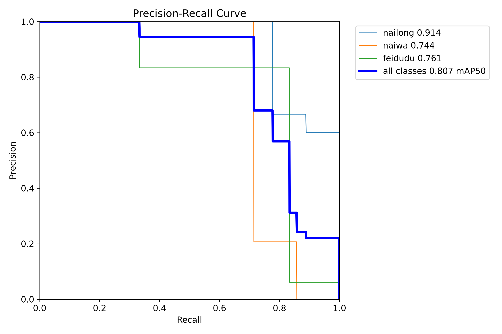
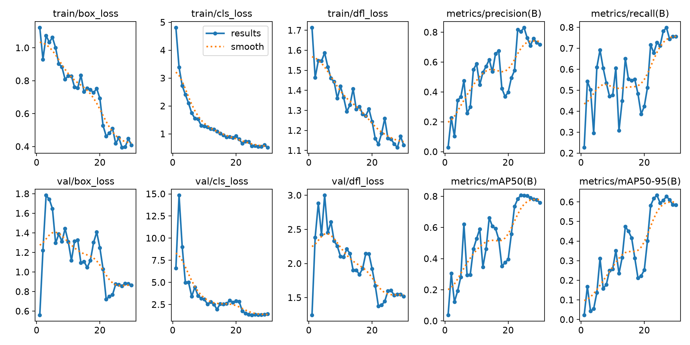
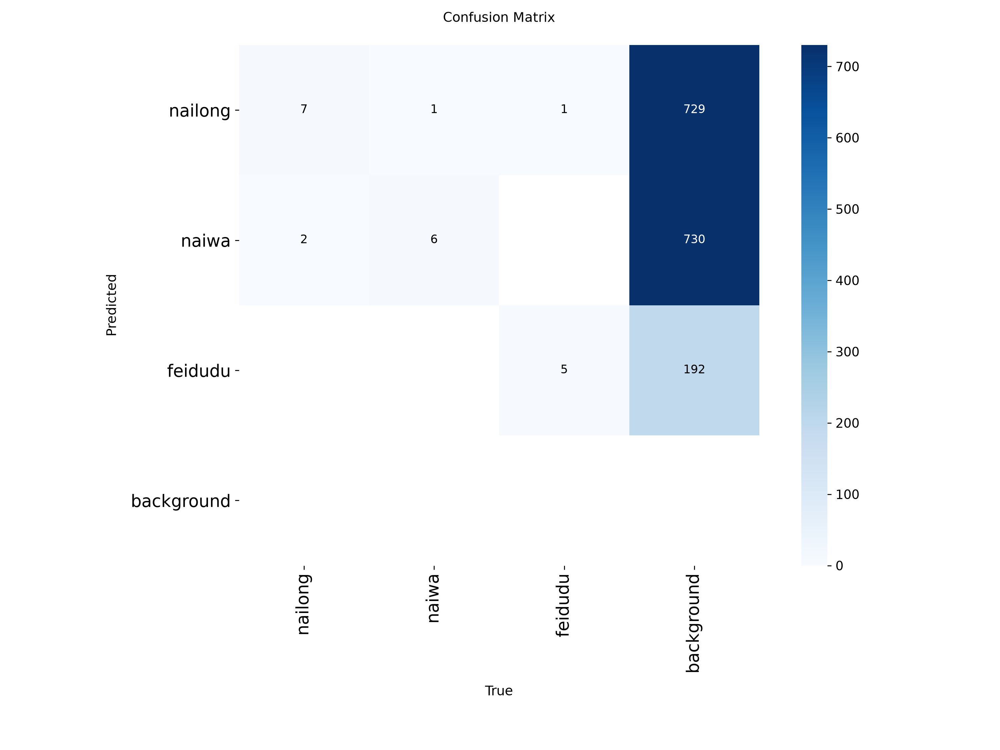

# 🐣 Nai Detect · YOLO11 动漫角色检测

<p align="center">
  <strong>奶龙、奶蛙、肥嘟嘟：三个角色，一块显卡，以及一个偶尔认错人的模型。</strong><br>
  YOLO11n · Object Detection · OpenCV Camera · Ubuntu
</p>

| 任务 | 模型 | 检测类别 | 当前阶段 |
| :---: | :---: | :---: | :---: |
| 矩形框目标检测 | YOLO11n | 3 类 | 已完成首版训练，支持本地推理与摄像头检测 |

> **作者友情提醒：作者是个菜鸡，模型垃圾，谨慎使用（会把人识别成目标【哈哈哈哈】）。**
>
> 当它给你框上一个 `nailong`，请先怀疑模型，别急着怀疑自己的物种。上面是作者的自嘲与使用反馈；“把人识别成目标”尚无随仓库提供的专项测试或截图，具体误检率待补充。

本项目用于学习自定义数据集准备、YOLO 检测标注、迁移学习、模型评估和摄像头推理。下面的数字来自本地标签、训练记录与权重元数据；没有把“感觉还行”写成“工业级精度”。

## 目录

- [项目介绍](#项目介绍)
- [项目效果](#项目效果)
- [技术栈与环境](#技术栈与环境)
- [数据集](#数据集)
- [模型训练](#模型训练)
- [训练结果](#训练结果)
- [项目结构](#项目结构)
- [环境安装](#环境安装)
- [使用教程](#使用教程)
- [模型权重](#模型权重)
- [局限性与改进方向](#局限性与改进方向)
- [数据版权及使用声明](#数据版权及使用声明)

## 项目介绍

Nai Detect 基于 Ultralytics YOLO11n，对网络热门卡通 IP **奶龙、奶蛙、肥嘟嘟（美团袋鼠）**进行矩形框检测。目标是在图片或摄像头画面中输出角色位置、类别和置信度，而不只是给整张图片贴一个标签。

当前实现包括：

- **自定义三类别检测**：权重内的类别名称与 `data.yaml` 一致。
- **摄像头逐帧推理**：[camera.py](./camera.py) 使用 OpenCV 读取默认摄像头，在窗口绘制检测框。
- **图片推理**：通过 Ultralytics Python API 或 CLI 加载本项目权重。
- **训练过程分析**：保存逐轮指标、训练曲线、PR 曲线和混淆矩阵。

`camera.py` 是一个简洁的本地演示脚本：加载权重 → 读取一帧 → 检测 → 绘框 → 显示。目标跟踪、视频录制、网页服务及 FPS 显示属于后续扩展方向。

## 项目效果

### 已有检测结果

本地保留了真实的验证预测拼图和 **21 张逐图预测结果**。检查现有拼图，可以看到三类角色均有检出，也能看到奶龙被误判为奶蛙、额外背景框等问题。它已经学会了一些东西，也还在一本正经地胡说八道。

| 本地结果位置 | 内容 |
| --- | --- |
| `runs/detect/runs/detect/nai_v1/val_batch0_pred.jpg` | 第一组验证预测拼图，可观察正确检测、错类及多余框 |
| `runs/detect/runs/detect/nai_v1/val_batch1_pred.jpg` | 第二组验证预测拼图 |
| `runs/detect/predict/` | 21 张逐图推理结果 |

**公开检测截图：待补充经授权可展示的图片。** 上述文件被当前 `.gitignore` 排除，且包含原始角色素材，因此不在 README 中嵌入这些图片，避免 GitHub 显示失效链接或未经授权再分发素材。下面直接展示已有的统计评估图；摄像头运行方法见[使用教程](#使用教程)。

### 真实 PR 曲线



图例显示各类 AP50 约为：奶龙 **0.914**、奶蛙 **0.744**、肥嘟嘟 **0.761**；这些是图中保留三位小数的读数。整体精确指标见[训练结果](#训练结果)。

## 技术栈与环境

| 组件 | 本地检查结果 | 用途 |
| --- | --- | --- |
| 系统 | Ubuntu 24.04.5 LTS | 开发与运行环境 |
| Python | 3.11.18 | 主开发语言 |
| Ultralytics | 8.4.203 | YOLO11 训练、验证与推理；权重记录版本相同 |
| PyTorch | 2.14.1+cu132 | 模型计算 |
| torchvision | 0.29.1+cu132 | PyTorch 视觉依赖 |
| CUDA runtime | PyTorch 构建标识为 13.2 | GPU 计算依赖，区别于系统 CUDA Toolkit 版本 |
| OpenCV | `opencv-python` 5.0.0.93 | 摄像头采集、窗口显示 |
| NumPy | 2.4.6 | 数组处理 |
| Conda | 本地环境名 `yolo11` | Python 环境隔离 |
| GPU | RTX 5060 Laptop（作者提供） | 原项目 GPU 环境说明 |

版本来自本地 `yolo11` 环境读取，不等同于最低版本要求。本次文档核查没有完成 GPU 推理或摄像头联调；驱动版本、独立环境复现和 FPS 测试数据待补充。

## 数据集

### 类别定义

| ID | 中文名称 | 英文标签 | 识别边界 |
| :---: | --- | --- | --- |
| 0 | 奶龙 | `nailong` | 与奶蛙分别标注，不能因都是黄色角色就合并 |
| 1 | 奶蛙 | `naiwa` | 按实际角色身份标注 |
| 2 | 肥嘟嘟（美团袋鼠） | `feidudu` | 特指相关表情包中的美团袋鼠形象，不泛指任意袋鼠 |

### 数据规模

| 数据 | 图片数 | YOLO 标签文件数 | 目标实例数 |
| --- | ---: | ---: | ---: |
| 原始素材 | 110 | — | — |
| 训练集 | 86 | 86 | 89 |
| 验证集 | 21 | 21 | 22 |
| 有效数据合计 | **107** | **107** | **111** |
| 暂缓纳入、待人工复核 | 3 | — | 尚未确定 |

训练集与验证集约为 **80.4% / 19.6%**。图片数不等于目标数：同一张图片可能包含多个目标，类别应按每个目标判断。

| 类别 | 训练集目标数 | 验证集目标数 | 合计 |
| --- | ---: | ---: | ---: |
| `nailong` | 37 | 9 | 46 |
| `naiwa` | 28 | 7 | 35 |
| `feidudu` | 24 | 6 | 30 |
| 合计 | **89** | **22** | **111** |

数据整理记录包含 78 个分组，保存了划分清单和分组信息；历史检查记录的跨集合相似图片对为 0。该记录代表当时检查结果，不能保证覆盖所有语义近似或后续新增图片。

三张待复核原图为 `nailong_041.jpg`、`naiwa_022.jpg`、`naiwa_031.jpg`，主要问题是低分辨率、模糊、遮挡，以及小角色身份或边界不明确。它们已从训练/验证集排除，原因保存在本地 `dataset/review/review_required.csv`。

### 标注与配置

采用 YOLO 检测格式，每个目标占一行，中心坐标和宽高均相对图片尺寸归一化到 0～1：

```text
class_id x_center y_center width height
```

[data.yaml](./data.yaml) 的实际配置为：

```yaml
train: dataset/images/train
val: dataset/images/val
nc: 3
names:
  0: nailong
  1: naiwa
  2: feidudu
```

**数据集不随 GitHub 仓库提供。** `/dataset/` 已被 `.gitignore` 忽略。克隆仓库后可以用权重对自己的图片推理；训练和验证需要另行准备有权使用的数据，并按配置放置。

## 模型训练

### 首版训练配置

训练参数来自 [args.yaml](./runs/detect/runs/detect/nai_v1/args.yaml)；实际优化器参数进一步与权重中的 `train_args` 交叉核对。

| 参数 | 实际记录 |
| --- | --- |
| 任务 / 基础模型 | `detect` / 预训练 `yolo11n.pt` |
| 模型规模 | YOLO11n；权重内模型参数量 2,605,369 |
| 训练轮数 | 30，CSV 含完整 30 轮记录 |
| 输入尺寸 | `imgsz=640` |
| Batch size / workers | `batch=8` / `workers=8` |
| 设备 / 混合精度 | `device=0` / `amp=True` |
| 优化器 | 输入配置为 `auto`；权重记录实际选用 `AdamW` |
| 初始学习率 | 输入配置 `lr0=0.01`；自动选择后的权重记录为 **0.001429** |
| 最终学习率比例 / 权重衰减 | `lrf=0.01` / `weight_decay=0.0005` |
| Warmup | 3 轮；权重记录 `warmup_bias_lr=0.0` |
| 随机种子 / 确定性设置 | `seed=0` / `deterministic=True` |
| 提前停止耐心值 | `patience=100`；本次记录完成 30 轮 |
| 损失权重 | `box=7.5`、`cls=0.5`、`dfl=1.5` |
| 数据增强 | `mosaic=1.0`、`fliplr=0.5`、`translate=0.1`、`scale=0.5` |
| HSV 增强 | `hsv_h=0.015`、`hsv_s=0.7`、`hsv_v=0.4` |
| Mosaic 关闭时机 | `close_mosaic=10`，最后 10 轮关闭 |
| 其他增强 | `mixup=0.0`、`cutmix=0.0`、`flipud=0.0` |

`optimizer=auto` 会自动选择优化器和初始学习率，因此不能把输入配置中的 `lr0=0.01` 当作实际采用值。[Ultralytics 训练文档](https://docs.ultralytics.com/modes/train/)

### 复现主要训练设置

**先准备自己的授权数据集。** 以下是依据保存配置整理的主要参数命令，不是原始终端命令的逐字备份；命令使用新实验名，避免覆盖首版结果。

```bash
yolo detect train \
  model=yolo11n.pt \
  data=data.yaml \
  epochs=30 batch=8 imgsz=640 device=0 workers=8 \
  optimizer=auto seed=0 deterministic=True amp=True \
  close_mosaic=10 \
  project=runs/detect name=nai_reproduce exist_ok=False
```

原训练使用的预训练文件路径是 `/home/jra/TDT/yolo11-test/yolo11n.pt`。上例换为可移植的 `yolo11n.pt`，首次使用时可能下载官方权重。使用相同版本、初始权重和划分有助于对比，但随机种子相同也不代表跨硬件结果逐位一致。

## 训练结果

### 最佳权重与最后一轮

下表取自 [results.csv](./runs/detect/runs/detect/nai_v1/results.csv)，并与 `best.pt`、`last.pt` 中的 `train_metrics` 一致。最佳权重的指标匹配 CSV **第 24 轮**；最后一轮为第 30 轮。

| 指标 | `best.pt` · 第 24 轮 | `last.pt` · 第 30 轮 |
| --- | ---: | ---: |
| Precision | **0.80300（80.30%）** | 0.71729（71.73%） |
| Recall | **0.72788（72.79%）** | 0.75661（75.66%） |
| mAP50 | **0.80659（80.66%）** | 0.76005（76.01%） |
| mAP50–95 | **0.63366（63.37%）** | 0.58429（58.43%） |

Precision 表示预测框的准确程度，Recall 表示标注目标的检出程度；mAP50 使用 IoU=0.50 的匹配标准，mAP50–95 对多个 IoU 阈值取平均。上述指标来自 **21 张验证图片、22 个目标**，没有独立测试集，不能当作未知场景准确率。指标的评估流程也不同于摄像头脚本固定 `conf=0.35` 的运行条件。[Ultralytics 验证文档](https://docs.ultralytics.com/modes/val/)

### 训练曲线



训练损失整体下降，验证指标存在明显波动；最高 mAP50–95 出现在第 24 轮，继续到第 30 轮没有进一步提升该指标。默认使用 `best.pt`，让模型拿自己考得最好的一张卷子出门。

### 混淆矩阵



现有混淆矩阵包含大量背景误检，以及奶龙/奶蛙之间的混淆。该图的独立生成命令、具体置信度阈值未单独保存，**不要直接用图中背景计数反推上表 Precision，或将它解释为 `conf=0.35` 的摄像头表现**。图表的生成条件有待进一步归档。

更多可查看 [F1 曲线](./runs/detect/runs/detect/nai_v1/BoxF1_curve.png)、[Precision 曲线](./runs/detect/runs/detect/nai_v1/BoxP_curve.png)、[Recall 曲线](./runs/detect/runs/detect/nai_v1/BoxR_curve.png) 和 [归一化混淆矩阵](./runs/detect/runs/detect/nai_v1/confusion_matrix_normalized.png)。

## 项目结构

以下是本地项目结构；标记为“仅本地”的数据及预览不随仓库发布。

```text
nai_detect/
├── README.md
├── .gitignore
├── camera.py                        # OpenCV 摄像头检测入口
├── data.yaml                        # 类别与数据路径
├── dataset/                         # 仅本地，Git 忽略
│   ├── raw/                         # 110 张原图
│   │   ├── nailong/
│   │   ├── naiwa/
│   │   ├── feidudu/
│   │   └── sources.csv              # 来源、版权及授权状态
│   ├── images/{train,val}/          # 86 / 21 张图片
│   ├── labels/{train,val}/          # 86 / 21 个标签
│   ├── review/review_required.csv   # 3 张待复核图片
│   └── annotation_audit/            # 统计、划分清单及分组信息
└── runs/detect/
    ├── predict/                     # 仅本地，21 张推理结果
    └── runs/detect/nai_v1/           # 实际保存路径，保留现有层级
        ├── args.yaml
        ├── results.csv
        ├── results.png
        ├── Box*_curve.png
        ├── confusion_matrix*.png
        ├── val_batch*_*.jpg         # 仅本地，验证标签/预测拼图
        └── weights/
            ├── best.pt
            └── last.pt
```

路径里确实有两层 `runs/detect`，不是 README 打字打出了回音。现有脚本按这个路径加载权重，使用时请保持一致。

## 环境安装

已配置好本地 `yolo11` 环境的作者可以直接激活，跳到[使用教程](#使用教程)。新环境可按以下步骤准备；这些是操作说明，不代表安装命令已在另一台机器验证。

### 1. 创建 Conda 环境

```bash
conda create -n nai-detect python=3.11 -y
conda activate nai-detect
```

### 2. 安装 PyTorch

前往 [PyTorch 官方安装页面](https://pytorch.org/get-started/locally/)，选择 **Linux / Pip / Python** 和适配显卡、驱动的 CUDA 构建，然后在已激活环境中执行页面给出的命令，安装 `torch` 与 `torchvision`。历史版本可参考[官方版本列表](https://pytorch.org/get-started/previous-versions/)。

本地检查到的是 `torch 2.14.1+cu132`，不表示所有电脑都应安装 CUDA 13.2，也不表示系统必须另装同版本 Toolkit；请以官方安装说明和驱动兼容性为准。

### 3. 安装检测与摄像头依赖

```bash
python -m pip install ultralytics==8.4.203 opencv-python==5.0.0.93
```

上例对应本地包版本；完整依赖锁定文件尚未提供，其他环境的包可用性与兼容性待验证。安装方式可参考 [Ultralytics 官方说明](https://docs.ultralytics.com/quickstart/)。摄像头脚本使用 `cv2.imshow`，应在支持图形显示的桌面会话中运行，并使用带 GUI 的 OpenCV 包。

### 4. 检查 GPU 是否可用

```bash
python -c "import torch; print('PyTorch:', torch.__version__); print('CUDA runtime:', torch.version.cuda); print('CUDA available:', torch.cuda.is_available())"
```

当前 `camera.py` 固定 `device=0`，需要 PyTorch 可以使用第一块 CUDA GPU。GPU 不可用时，可以先用后面的 CPU 图片推理示例检查权重加载。

## 使用教程

所有相对路径都以**仓库根目录**为起点。作者本地运行位置为：

```bash
conda activate yolo11
cd /home/jra/TDT/yolo_11_project/nai_detect
```

其他电脑请激活自己创建的环境，并切换到实际克隆目录。

### 摄像头检测

```bash
python camera.py
```

| 行为 | 源码中的实际设置 |
| --- | --- |
| 权重 | `runs/detect/runs/detect/nai_v1/weights/best.pt` |
| 摄像头 | `cv2.VideoCapture(0)`，默认设备索引 0 |
| 推理设备 | `device=0`，第一块 CUDA GPU |
| 置信度阈值 | `conf=0.35` |
| 绘制方式 | `results[0].plot()` |
| 窗口标题 | `Nai Detect` |
| 正常退出 | 焦点在检测窗口时按小写 `q`；读取失败也会结束循环 |

摄像头无法打开时，程序抛出 `RuntimeError("无法打开摄像头")`。可先检查系统是否识别摄像头、设备访问权限以及是否被其他程序占用。脚本中的设备与阈值是固定配置，没有命令行参数解析。

### 图片推理：Python

将 `your_image.jpg` 替换为自己有权使用的图片路径：

```python
from ultralytics import YOLO

model = YOLO("runs/detect/runs/detect/nai_v1/weights/best.pt")
results = model.predict(
    source="your_image.jpg",
    conf=0.35,
    imgsz=640,
    device="cpu",  # CUDA 环境可改为 0
    save=True,
    project="runs/inference",
    name="image_demo",
    exist_ok=False,
)

for result in results:
    print(result.boxes.xyxy)  # 像素坐标：左上角、右下角
    print(result.boxes.cls)   # 类别 ID
    print(result.boxes.conf)  # 置信度
```

### 图片推理：CLI

```bash
yolo detect predict \
  model=runs/detect/runs/detect/nai_v1/weights/best.pt \
  source=your_image.jpg \
  imgsz=640 conf=0.35 device=cpu save=True \
  project=runs/inference name=image_demo exist_ok=False
```

示例会保存带框结果，输出位置以终端打印的路径为准；同名实验已存在时可能自动编号。若使用上述新输出目录，发布前也应检查图片授权及 Git 提交范围，当前忽略规则只覆盖已有的部分结果目录。[Ultralytics 推理文档](https://docs.ultralytics.com/modes/predict/)

### 验证模型（需要本地数据集）

```bash
yolo detect val \
  model=runs/detect/runs/detect/nai_v1/weights/best.pt \
  data=data.yaml split=val imgsz=640 batch=8 device=0 \
  project=runs/evaluation name=best_check exist_ok=False
```

这会运行评估并产生新的输出；不会启动训练。仓库不含数据集，直接克隆后需要先补齐授权图片和标签。

## 模型权重

| 权重 | 相对路径 | 文件大小 | 建议用途 |
| --- | --- | ---: | --- |
| [best.pt](./runs/detect/runs/detect/nai_v1/weights/best.pt) | `runs/detect/runs/detect/nai_v1/weights/best.pt` | 5,504,218 字节，约 5.25 MiB | 默认推理与最佳结果对比 |
| [last.pt](./runs/detect/runs/detect/nai_v1/weights/last.pt) | `runs/detect/runs/detect/nai_v1/weights/last.pt` | 5,504,218 字节，约 5.25 MiB | 最后一轮推理、进一步微调的起点 |

两份权重均可通过 `YOLO("权重路径")` 加载。检查发现，它们已移除优化器状态，`optimizer=None`、`epoch=-1`，因此 **`last.pt` 不能视为能够无损恢复第 30 轮优化器状态的断点**；继续学习可以加载权重开始新的微调实验。

## 局限性与改进方向

| 当前局限 | 后续方向 |
| --- | --- |
| 只有 107 张有效图片，验证集仅 21 张 | 扩充有权使用的数据，建立独立测试集与来源隔离的验证方案 |
| 奶龙和奶蛙外观相近，已观察到错类 | 增加易混姿态、局部遮挡与不同风格的对照样本 |
| 现有结果有背景误检；作者反馈还可能把人框进去 | 补充人物、玩具和复杂背景等负样本，建立专门的误检测试集 |
| 小目标、模糊或遮挡边界不可靠 | 复核疑难标注，补充高质量、多尺度数据 |
| 单次训练中后期指标回落 | 比较验证策略、数据增强和学习率，使用独立数据检查泛化 |
| 缺少统一阈值下的展示记录 | 固定并记录 `conf`、IoU、权重版本与评估命令 |
| 摄像头演示尚无公开基准 | 补充授权演示图、设备信息、端到端 FPS 与延迟测试 |

当前没有独立测试集成绩、逐类完整数值表、标准 FPS 或可靠的真实场景误检率，这些都属于待补充信息。学习可以快乐，指标还是得老实。

## 数据版权及使用声明

- 本地原始素材来自互联网既有图片，本项目收集过程未生成 AI 图片；上游素材的制作方式并未全部核实。
- 每张素材的来源、原图链接及已知版权/许可状态记录在本地 `dataset/raw/sources.csv`。记录中 **110 张图片的模型训练授权均尚未确认**；公开可访问不等于允许训练、商业使用或再分发，学习用途说明也不等于已取得授权。
- 奶龙、奶蛙和肥嘟嘟等角色及对应图片的权益归各自权利人所有。本项目不代表相关 IP 方，不授予角色或素材使用许可。
- **原始图片、训练/验证图片及含这些素材的检测预览不随 GitHub 仓库发布。** 如需公开演示，应另行确认展示权限。
- 权重元数据标记 `AGPL-3.0`，Ultralytics 的适用条款请阅读[官方许可说明](https://www.ultralytics.com/license)。代码/框架许可与素材/角色授权需要分别确认；该标记不代表取得了图片或角色授权。
- 本项目尚未提供独立的 `LICENSE` 文件，也未完成模型公开分发授权的全面核查；README 不授予额外许可。公开发布权重、再分发或商业使用前，应补齐相关授权及许可说明。

欢迎交流学习和复现实验。至于模型偶尔认错角色——欢迎指出，作者和模型一起补课。
